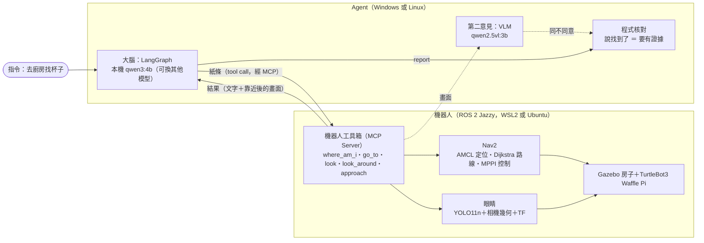
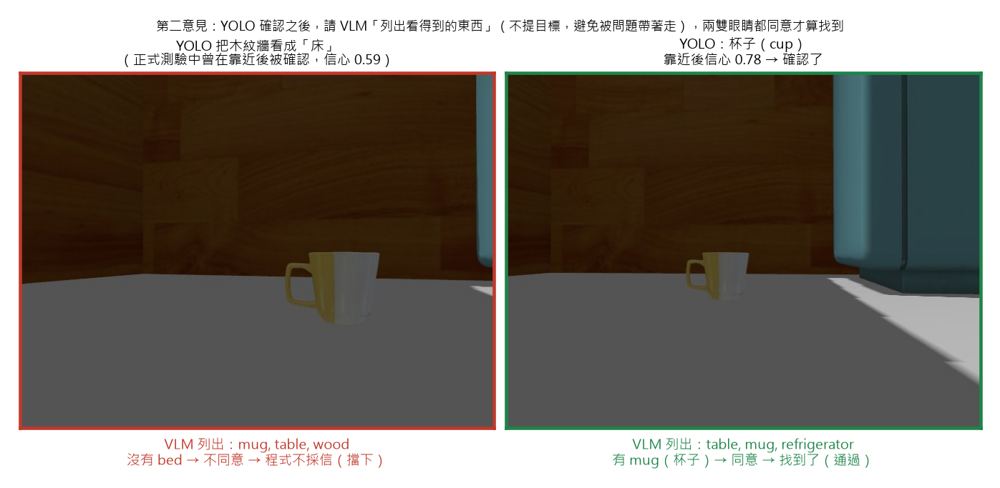
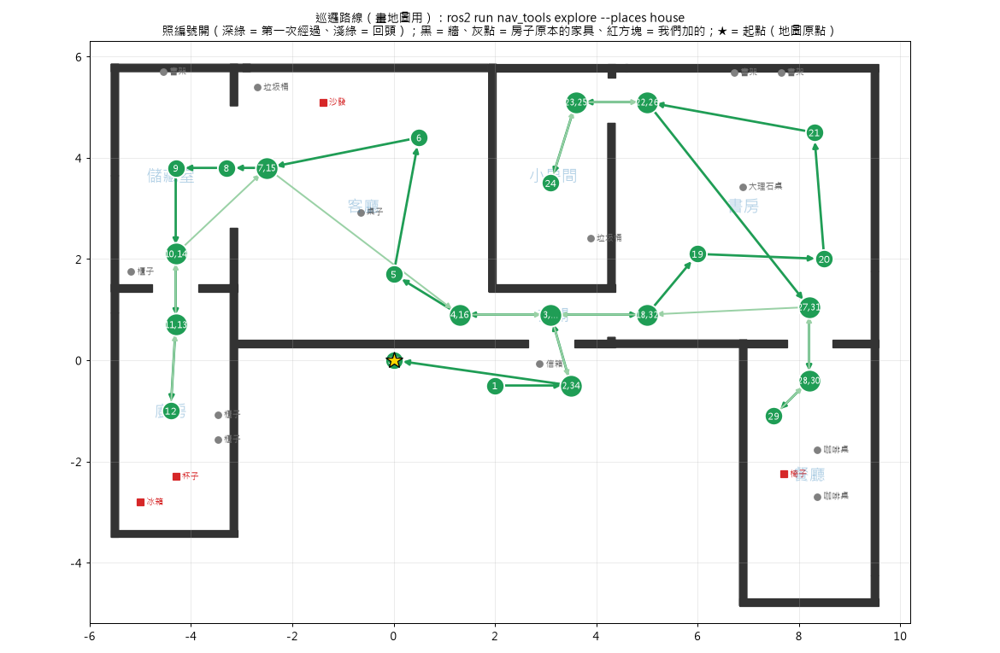
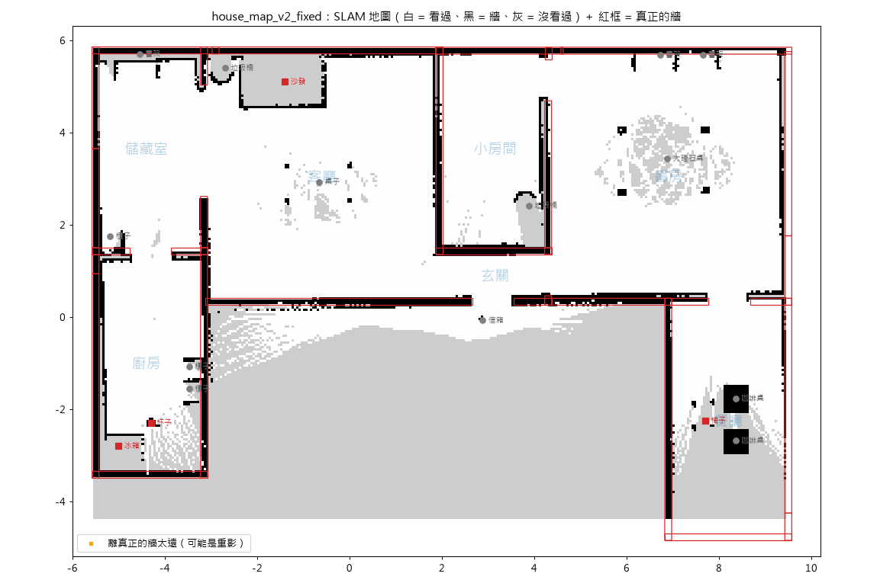

# 會找東西的機器人：語言模型 Agent × ROS 2 導航 × YOLO／VLM

> **LLM Robot Finder** — A language-model agent that finds objects in a simulated house.
> It plans with an LLM (local **qwen3:4b**), navigates with **ROS 2 Nav2**, looks with **YOLO**,
> double-checks with a **VLM**, and never reports "found" without evidence.
> Evaluated on 9 tasks × 3 LLMs, with ground-truth grading.

在 Gazebo 模擬的房子裡說「**去廚房找杯子**」，機器人自己決定去哪裡、看什麼、要不要靠近確認，最後誠實回報。
**本機 40 億參數的小模型就做到 9/9**；測驗找出 5 個設計盲點，修好後重考。

https://github.com/user-attachments/assets/780101f5-d281-4d52-ae15-1dc30574b7f8

▲ 示範影片（49 秒，中英字幕）：左邊是 Gazebo 模擬，右邊是 Agent 的思考過程；開車和思考的片段有加速（畫面右上角標示倍速）。
上面的影片沒有出現的話，可以直接看 [docs/demo.mp4](docs/demo.mp4)。

---

## 架構



| 元件 | 做什麼 |
|---|---|
| **大腦**（LangGraph＋語言模型） | 讀指令、決定下一步用哪個工具；判斷看到的東西合不合理（廚房有床？多半是把牆看錯） |
| **機器人工具箱**（MCP Server） | 把 ROS 2 的能力包成 5 個工具；任何支援 MCP 的 Agent 都能接 |
| **Nav2** | 定位（AMCL 粒子濾波）、規劃路線、避障、卡住時自救 |
| **眼睛**（YOLO＋相機幾何） | 看 1～5 秒（預設 1.5 秒）、統計每樣東西出現在幾成畫面；用框的位置和相機參數算出它在地圖上的哪裡 |
| **第二意見**（VLM） | YOLO「確認了」之後，請 VLM 列出畫面裡看得到的東西；VLM 沒提到目標就不算找到（VLM 出錯時只看 YOLO） |
| **程式核對** | 大腦說「找到了」，就要有 approach 確認＋VLM 沒反對的紀錄，否則退回、再犯就不採信 |

---

## 設計重點：怎麼做到「不說謊、不被騙」

1. **大腦只寫紙條，不直接控制輪子**：房間名稱只能從清單選、要找的東西只能是 YOLO 認得的類別——模型沒辦法亂編
2. **先懷疑、再確認**：遠看信心低的東西，要 `approach` 靠近再看；「確認」由程式依規則判定（8 成以上的畫面看得到、信心 ≥ 0.5），不是模型說了算
   - 停多遠看東西大小：相機離地只有 10 公分，沙發、冰箱靠太近只拍到底部，反而認不出來（小東西 0.6、椅子 1.0、大東西 1.4 公尺）
3. **第二意見**：小 VLM 會被問題帶著走——問「有沒有床？」它就說有，還說「杯子放在床上」。
   所以**問題裡不提目標**，只請它「List the objects you can see」，再由程式比對清單（含同義詞：cup ↔ mug）
4. **核對證據，不聽說法**：模型的話是「旁白」，程式查到的才是「事實」
5. **上限由程式管**：最多 15 次工具、約 10 分鐘（每一步做完就檢查，正在跑的工具會先跑完）



---

## 測驗

9 題 × 3 個大腦。每題重新接上工具箱（記憶清空）、從前院出發；**依「真相」自動評分**（模擬裡知道每樣東西在哪），不看大腦怎麼說。

| 類別 | 指令 | 正確答案 |
|---|---|---|
| 找得到 | 去廚房找杯子、去客廳找沙發、去餐廳找椅子 | 找到，位置在真正位置 0.7 公尺內 |
| 沒說房間 | 找杯子、找冰箱 | 自己想到先去廚房 |
| **長得像** | 去廚房找床（說明書裡的例子）、去客廳找椅子、去小房間找火車 | 沒有——那是 YOLO 把牆、垃圾桶看錯 |
| 不存在 | 找手機 | 沒有說找到 |

「說明書」是給大腦的系統提示（`agent/robot_agent.py` 的 `RULES`），裡面舉了「廚房有床，多半是把牆看錯」當例子。
「長得像」的新題（說明書沒舉過的例子）用來檢查大腦是真的有常識，還是只會背說明書。

### 成績

| 大腦 | 第一版（沒有 VLM） | 第二版（加上 VLM 第二意見） |
|---|---|---|
| **qwen3:4b**（本機 Ollama） | **9/9** | **9/9** |
| Gemma 4 E4B（遠端伺服器） | 9/9 | 7/9（1 題程式出錯沒考到，算錯） |
| gpt-6-luna（遠端 API） | 8/9（**被騙 1 次**） | 9/9 |

Gemma 第二版：冰箱靠近 4 次，信心都在 0.43～0.49，差一點到 0.5；「找手機」那題連線出錯、一個工具都沒用到，評分程式原本把它算成「沒被騙」，公開前檢查才發現並改成無效。

找沒有的東西時，用滿上限被強制停止也算「沒被騙」（它沒有說找到），但代表大腦不會自己收尾：第一版 2 次、第二版 3 次，多半是「找手機」一直換房間找。

完整紀錄：[第一版](agent/results/run1_no_vlm/)、[第二版](agent/results/run2_with_vlm/)（每題的工具呼叫、大腦的回覆，qwen3:4b 另有每一步的思考（最多存 2000 字）；評分以 `_summary.md` 為準）

### 測驗教會我的事
- **本機 4B 小模型 ≈ 雲端大模型**：工具設計、說明書、程式核對分擔了大部分的工作，大腦只要做好判斷
- **核對員只能防「說謊」，不能防「被騙」**：第一版中，YOLO 靠近後還是把木紋牆看成床（信心 0.59），證據本身就是錯的 → 加上 VLM 第二意見
  - 整合測試：重現「木紋牆被認成床」的畫面＋「確認了床」→ VLM 列出 mug, table, wood → **擋下**；真的杯子 → **通過**
  - 第二版正式測驗中 VLM 被問了 16 次，**全部同意**（真的東西沒有被誤擋）；但這次 YOLO 沒有誤確認，被騙 1 → 0 **不能全算 VLM 的功勞**
- **每題只考一次有運氣成分**：YOLO 每次的信心不同、大腦有隨機性 → 比較兩個版本時，要分清楚「改進」和「運氣」
- **分數怪的時候，先查考試本身**：評分程式錯過三次（機器人卡住讓後半段無效；在別的房間找到真的椅子被當成「被騙」；程式出錯、沒考到的題目被當成「沒被騙」）

---

## 測驗找到、修好的盲點

| 現象 | 原因 | 修法 |
|---|---|---|
| 機器人卡死在廚房 | 杯子約 10 公分高，**比雷射（12 公分）還矮**，Nav2 看不到它，路線直接穿過去 | 把雷射看不到的矮東西畫進導航地圖 |
| 沙發、冰箱靠近後反而認不出來 | 相機離地 10 公分、上下只看得到 ±24 度，靠太近只拍到底部 | 依東西大小決定停多遠 |
| 第一趟出不了大門 | 出生點離牆 25 公分，在代價地圖裡等於「貼著牆」（代價 99），規劃不出路 | 設定起點後先往外挪 0.3 公尺；代價地圖的機器人半徑 0.22 → 0.20（近似值：從旋轉中心量，車身後角約 0.24，靠外圈緩衝補足） |
| 畫地圖時目的地一直「在地圖外」 | SLAM 要移動 0.5 公尺或轉約 30 度才收新的雷射；雷射只看得到 3.5 公尺 | 巡邏程式：開不到就原地轉頭、往目標走一半再試 |
| 小 VLM 什麼都說「有」 | 問題裡提到什麼，它就容易「看到」什麼（誘導式問題） | 不提目標，只請它列出看到的東西，由程式比對 |

另外還有：WSL 的系統時鐘被兩個校時程式互搶（每 5 秒跳 ±40 秒，座標轉換資料一直被丟）、SLAM 偶爾開機卡在「未啟動」、Gazebo 橋接的速度訊息格式對不上（機器人完全不動）。

---

## 執行

### 需求
- Ubuntu 24.04（或 Windows 11 + WSL2 Ubuntu 24.04）、Gazebo Harmonic、
  ROS 2 Jazzy（先照[官方安裝說明](https://docs.ros.org/en/jazzy/Installation/Ubuntu-Install-Debs.html)加入 ROS 2 的 apt 套件來源）
- 顯示卡選用（YOLO 用 GPU 比較順；開發時用 RTX 5070 12 GB）
- Agent：Python 3.12、[uv](https://docs.astral.sh/uv/)、[Ollama](https://ollama.com/)

以下指令都在**這個專案的資料夾**裡執行（Ubuntu 或 WSL 的終端機）。

### 1. ROS 2 套件與 Python 環境（只做一次）
```bash
sudo apt install ros-jazzy-desktop ros-jazzy-navigation2 ros-jazzy-nav2-bringup ros-jazzy-slam-toolbox \
                 ros-jazzy-ros-gz ros-jazzy-turtlebot3-gazebo ros-jazzy-vision-msgs python3-colcon-common-extensions
echo "source /opt/ros/jazzy/setup.bash" >> ~/.bashrc && source ~/.bashrc
bash setup/setup_yolo_env.sh       # ~/yolo_venv：ultralytics、numpy<2（ROS 需要）、mcp
bash setup/upgrade_yolo_gpu.sh     # 選用：有 NVIDIA 顯示卡時換成 CUDA 版 PyTorch

mkdir -p ~/ros2_ws/src && ln -s "$(pwd)"/ros2_ws/src/* ~/ros2_ws/src/
(cd ~/ros2_ws && source ~/yolo_venv/bin/activate && python -m colcon build --symlink-install)  # 用這個環境的 Python 組裝，工具箱才找得到 YOLO
echo "source ~/ros2_ws/install/setup.bash" >> ~/.bashrc && source ~/.bashrc   # 之後每個新終端機都會自動載入
```

### 2. 開模擬＋導航（第一次會從 Gazebo Fuel 下載冰箱、杯子、沙發、椅子的模型）
```bash
# 終端機 1（會一直佔著）
ros2 launch home_sim house_nav.launch.py map:=$(pwd)/maps/house_map_v2_fixed.yaml
# 終端機 2，1 分鐘內：告訴機器人它在起點，並挪離牆邊
ros2 run nav_tools set_start --places house
```

### 3. Agent（Linux：終端機 2；Windows：PowerShell 進到這個專案的資料夾）
```bash
cd agent
uv sync
ollama pull qwen3:4b
ollama pull qwen2.5vl:3b
uv run python robot_agent.py --think "去廚房找杯子"     # --think 顯示大腦每一步的思考
uv run python eval_agent.py                              # 9 題測驗（--no-vlm 關掉第二意見）
```
- Windows 上，Agent 會透過 `wsl.exe` 叫起**預設 WSL 發行版**裡的工具箱（要是裝了 ROS 2 的那個，例如 `wsl --set-default Ubuntu-24.04`）；
  Linux 上直接執行（`ROBOT_WS` 指定工作區位置，預設 `~/ros2_ws`）
- 模擬那邊的 `ROS_DOMAIN_ID` 不是 0 的話，Agent 這邊也要設成一樣
- 換成雲端模型：`LLM_PROVIDER=remote`，再設定 `REMOTE_BASE_URL`、`REMOTE_API_KEY`、`REMOTE_MODEL`（任何 OpenAI 相容的服務）；
  測驗用 `--brains remote` 或 `--brains ollama,remote`
- 其他設定：`AGENT_MODEL` 換本機模型、`SECOND_OPINION=0` 關掉 VLM 第二意見、`REMOTE_EXTRA` 給遠端服務的額外參數（例如 `{"reasoning_effort": "none"}`）
- 這些設定可以用環境變數，也可以寫在 `agent/.env`（已被 `.gitignore` 擋住）

### 4. （選用）自己重畫地圖
```bash
# 終端機 1
ros2 launch home_sim house_nav.launch.py slam:=True
# 終端機 2（在這個專案的資料夾）
ros2 run nav_tools explore --places house          # 照 35 個路線點自動巡邏一圈（約 8 分鐘）
ros2 run nav2_map_server map_saver_cli -f maps/house_map_new
~/yolo_venv/bin/python tools/house_plan.py check maps/house_map_new.yaml   # 疊上真正的牆：漏畫、重影、缺口
~/yolo_venv/bin/python tools/house_plan.py patch maps/house_map_new.yaml   # 補上灰色的牆、畫上雷射看不到的矮東西
```



`check` 的輸出：SLAM 地圖疊上從房子模型讀出來的真正的牆（紅框）。圖上的中文需要 CJK 字型（Ubuntu：`sudo apt install fonts-noto-cjk`）



---

## 檔案

| 位置 | 內容 |
|---|---|
| `agent/robot_agent.py` | Agent：LangGraph（大腦 ⇄ 工具 → 核對）、VLM 第二意見 |
| `agent/eval_agent.py` | 9 題測驗、依真相評分（`--summary` 用存好的紀錄重新評分） |
| `ros2_ws/src/robot_tools/` | 機器人工具箱：`mcp_server.py`（5 個工具）、`eyes.py`（YOLO＋相機幾何＋TF）、`approach.py` |
| `ros2_ws/src/nav_tools/` | `go_to`、`set_start`、`explore`（巡邏畫地圖）、地點表 `places_house.yaml` |
| `ros2_ws/src/home_sim/` | 房子世界（TurtleBot3 房子＋冰箱、杯子、沙發、椅子）、啟動檔 |
| `ros2_ws/src/yolo_vision/` | 影像格式轉換；YOLO 包成 ROS 2 節點 |
| `maps/` | SLAM 畫的地圖（`house_map_v2`）、補好牆的導航地圖（`house_map_v2_fixed`） |
| `tools/house_plan.py` | 從房子模型讀出真正的牆：畫路線、檢查地圖、補牆 |

---

## 關於

這是我自學 AI 與機器人的作品：從 ROS 2 基礎、Nav2 導航，到把語言模型 Agent 接上機器人。
開發過程以 Claude Code 當教練，一起討論、一起學習：從系統設計的取捨、測驗怎麼出，到結果怎麼解讀，都是邊做邊討論出來的。

授權：MIT。使用的開源專案：TurtleBot3（ROBOTIS）、Nav2、slam_toolbox、Gazebo、Ultralytics YOLO（AGPL-3.0）、LangGraph、MCP Python SDK；
Gazebo Fuel 上的模型依各自的授權，執行時才下載，不包含在這個專案裡。
